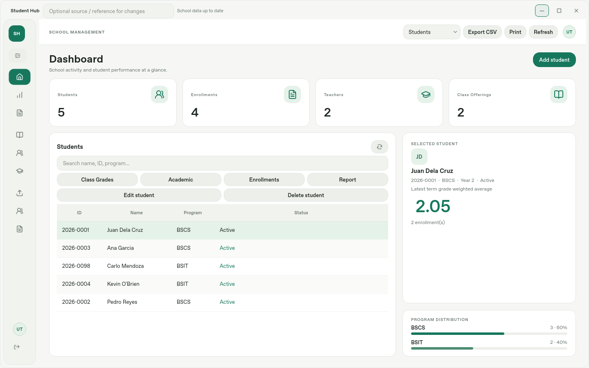

# Student Information and Grading System

Python/PySide6 desktop application with PostgreSQL persistence. `main.py` is the
only launcher. The interface, services, repositories and calculator remain
separate; there is no web server.

## Install and run

Use Python 3.12 or later supported by the pinned dependencies and PostgreSQL 13+
(verification uses PostgreSQL 17). Create a virtual environment, then:

```bash
python -m pip install -r requirements.txt
```

Copy `.env.example` to `.env` and configure the intended PostgreSQL database.
Create the database first. For a new database, the installer creates the schema;
do not execute old schema files or seed school records:

```bash
python -m app.database.apply_migration --preflight
python -m app.database.apply_migration --all
python main.py
```

The first launch creates your initial Admin account; no default password is
provided. A graphical desktop/display is required for interactive use.
`STUDENT_HUB_REDUCED_MOTION=1` reduces animations.

### Desktop appearance

The interface uses a white light theme with green accents across the dashboard, tables,
editors, grading controls and sign-in screen. Navigation starts as a compact
icon rail; hover for page names or use **Expand navigation** below the SH mark
to show labels. Expanding the rail preserves the current page and role access.
Keyboard focus remains visible, and status labels retain their text as well as
their color. The existing reduced-motion setting also applies to this theme.



### Existing databases

Close the application and back up the database before an upgrade. `--preflight` reports inventories and
conversion blockers without changing records. `--all` converts a recognized
legacy schema transactionally, preserves original domain/account/audit records
in a uniquely named `legacy_rubric_*` archive schema, and keeps existing IDs.
Repeated installation on the current version is a no-op. An incompatible layout
or a category weight that cannot split exactly into two-decimal component weights
stops conversion; it does not reset records or approximate grades.

Existing components are not automatically merged on name alone. Existing
legacy percentage-only grades remain archived if they cannot supply the required
period data; recompute those enrollments. Historic unknown actors/provenance are
not invented. Legacy free-text schedules are preserved; open the class editor
to confirm their explicit days and AM/PM times before relying on timetable checks
for those classes. Migration does not guess ambiguous times.

## Rubric database and workflows

The physical domain tables are `student`, `teacher`, `subject`, `class`,
`enrollment`, `grading_period`, `grade_component`, `grade_percentage`,
`grade_component_score`, `grade`, and `audit_log`. PostgreSQL normalizes their
unquoted uppercase equivalents to these lowercase names. Inspect them directly
in your PostgreSQL client.

Components belong to periods and are shared across classes. Each
`grade_percentage` links one class to one component. Use Academic to maintain
shared definitions, then Class Grades → Period Setup to select components and
save the complete class configuration atomically. Every period totals 100%;
overall period weights also total 100%. Teachers configure only their own
classes; Admin/Dean manage shared definitions.

Scores are linked to an enrollment and assigned component. Correcting a score
updates its existing row. Missing scores block calculation; enter explicit zero
when appropriate. **Save Midterm** saves a partial result; **Save Grades** saves
Midterm, Finals and Overall in one `grade` row per enrollment. Recalculation
updates that row. Grade-point conversion uses the unrounded percentage and one
central scale. `final_equiv` is the Overall equivalent used for FG/F Grade.

Class List, Grade Sheet and Student Grade reports read saved records. Missing,
unsaved and outdated results are labelled. GWA is the units-weighted average of
subject final grade points. Tables retain CSV export, print preview, spreadsheet
formula escaping and HTML escaping.

### Selectable schedules

Class schedules use weekday checkboxes and start/end time controls with AM/PM.
Add another time block when meeting times differ by day. `class.schedule` holds
the rubric's display string; `class_meeting` stores explicit weekday/time values.
Within the same school year/semester, overlapping meetings cannot share a
teacher, room or actively enrolled student. Adjacent end/start times are allowed.
Dropping an enrollment frees its timetable slot; restoring it checks conflicts
again. Section names alone are not unique cohorts.

### Provenance and audit

The optional source/reference control in the title bar applies to writes.
Academic and policy dialogs also offer a source field. For the live rubric
scenario, enter references such as `ST-01`, `GR-03` or `Report setup`. They are
stored as ordered unique `set_by` references. They are not usernames.

`created_by`, `updated_by`, timestamps and `audit_log.changed_by` identify actual
application actors. Data Records shows stored provenance; Admins can inspect
before/after audit history in Class Grades. No-op updates do not invent changes.
Accounts/permissions and protected atomic batch deletion are documented in
[accounts and roles](docs/accounts_and_roles.md).

## CSV import

The CRUD document’s final appendix dataset is ready to import from
[`test_data/crud_test_case`](test_data/crud_test_case/README.md). Select that folder
in Data Import to load the five students, two classes and four saved grades.

Canonical imports support the rubric-shaped columns, optional emails/year levels,
structured class meetings, policies and consolidated grades. Import validation
runs the actual PostgreSQL constraints inside a rolled-back transaction. A failed
import leaves no saved rows or audit changes. Duplicate input identifiers are
rejected. Omitted fields stay unchanged; supplied blank optional fields become
NULL. Provided meeting rows replace that class's complete meeting set atomically.

The bundled `test_data` is explicitly a legacy-format example. It is converted
using the same exact category-to-component rule as migration. Original legacy
CSV data is retained in `import_archive`; percentage-only grades are not
fabricated into period results. Review missing schedules and configure periods
before calculating current reports. See [dataset instructions](test_data/README.md).

## Verification

```bash
QT_QPA_PLATFORM=offscreen python -m pytest -q
```

To include PostgreSQL acceptance, migration, role, scheduling and import tests,
set `CHECKLIST_TEST_DSN` to a disposable test database whose user can create/drop
schemas. Do not use production credentials. Each test creates its own generated
schema and removes it afterward.

```bash
CHECKLIST_TEST_DSN='host=localhost port=5432 dbname=grading_test user=tester' \
QT_QPA_PLATFORM=offscreen python -m pytest -q
```

On PowerShell, set `$env:QT_QPA_PLATFORM='offscreen'` and
`$env:CHECKLIST_TEST_DSN='...'` before `python -m pytest -q`.

`tests/test_checklist_database.py` executes all 52 cases using real application
services, verifies exact final table contents, and opens a second GUI process to
check persistence and the 2.05 weighted report. Its comparison artifact defaults
to `/tmp/student-rubric-comparison.json`; override with `RUBRIC_COMPARISON_PATH`
on other systems. The rubric's final counts apply after that fresh-database
scenario, not to every user's school dataset. Surrogate IDs may differ as the
document permits. Physical printing and the instructor's live demonstration
remain manual checks. See [rubric evidence](docs/checklist_audit.md).
